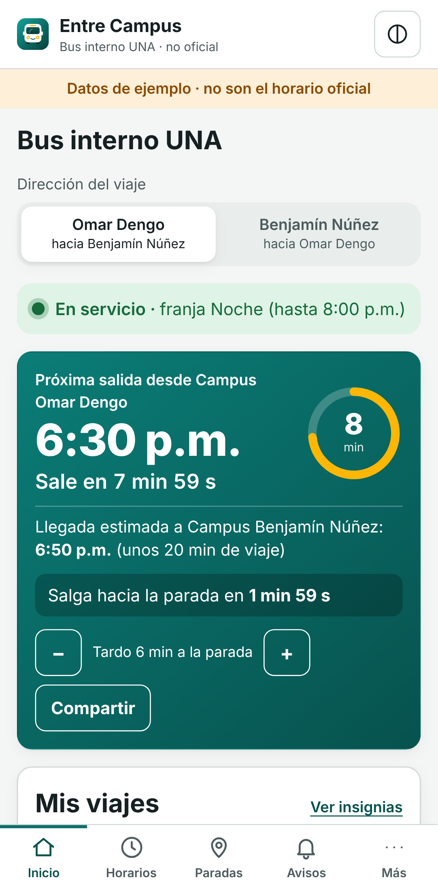
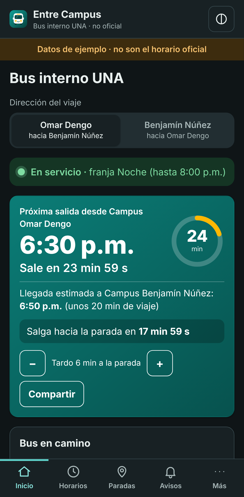
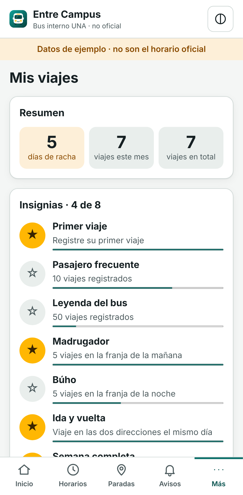
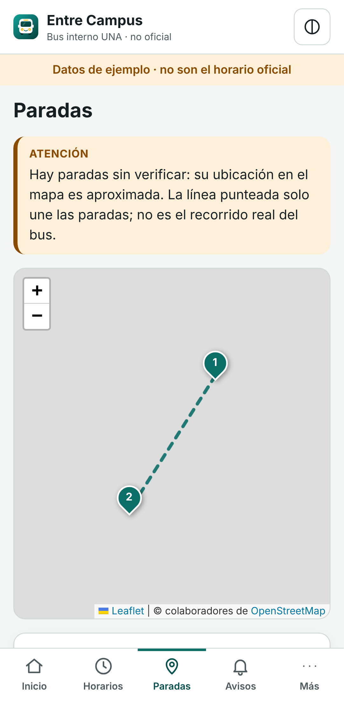

<p align="center"></p>

# Entre Campus

PWA que informa sobre el bus interno de la Universidad Nacional (UNA, Costa Rica) entre el **Campus Omar Dengo** (Heredia) y el **Campus Benjamín Núñez** (Lagunilla): estado del servicio, próxima salida con cuenta regresiva, horarios, paradas y avisos.

> **Proyecto independiente y no oficial.** No está afiliado a la UNA.
> Los horarios y las paradas incluidos hoy son **datos de ejemplo** (`"ejemplo": true`) hasta que se carguen los oficiales.

| Inicio | Tema oscuro | Mis viajes | Paradas |
| --- | --- | --- | --- |
|  |  |  |  |

## Qué hace

- Estado en vivo: «En servicio · franja Noche (hasta 8:00 p.m.)», «Fuera de servicio · próxima franja: Mediodía, 12:00 m.d.», «El servicio vuelve el lunes a las 6:00 a.m.».
- Próxima salida con cuenta regresiva y hora estimada de llegada.
- «¿Me da tiempo?»: indique cuánto tarda en llegar a la parada y la app le dice cuándo salir.
- Bus en camino: posición estimada según el horario (no es GPS).
- Mis viajes: registro personal con racha e insignias, guardado solo en el dispositivo.
- Línea de tiempo de las franjas y lista de salidas del día.
- Feriados, fin de ciclo y errores de carga con mensajes claros.
- Funciona sin conexión e indica de qué fecha son los datos.
- Mapa de paradas (Leaflet + OpenStreetMap, sin claves de API).
- Exportación del horario a calendario (`.ics`).
- Notificaciones push antes de cada salida o franja (Cloudflare Workers).
- Toda la lógica de tiempo usa `America/Costa_Rica`, sin importar la zona del dispositivo.
- Accesible (WCAG 2.2 AA), tema claro y oscuro, sin rastreo.

## Cómo correrlo

Requiere Node 22 o superior.

```bash
cd entre-campus
npm install
npm run dev          # http://localhost:5173
```

Para ver la app a una hora concreta, agregue `?ahora=` con una fecha ISO:

```
http://localhost:5173/?ahora=2026-11-25T18:10:00-06:00
```

| Comando | Qué hace |
| --- | --- |
| `npm run dev` | Servidor de desarrollo |
| `npm run build` | Valida los datos, revisa tipos y compila a `dist/` |
| `npm run preview` | Sirve `dist/` en `http://localhost:4173` (con service worker) |
| `npm run validar` | Valida `public/data/*.json` con el esquema Zod |
| `npm test` | Pruebas unitarias (Vitest) |
| `npm run e2e` | Pruebas de extremo a extremo y de accesibilidad (Playwright + axe). Requiere `npm run build` antes |
| `npm run lint` · `npm run typecheck` | ESLint y TypeScript |
| `npm run verificar` | Todo lo anterior, en orden |

## Cómo actualizar el horario (solo JSON)

No hace falta tocar código.

1. Edite el archivo del ciclo en [`public/data/`](public/data), por ejemplo `I-2027.json`:
   - `franjas`: hora de `inicio`, `fin` y `frecuenciaMin` de cada franja.
   - `salidasExactas`: si la fuente publica horas exactas, póngalas aquí (`{ "lunes-viernes": ["06:00", "06:25"] }`) y tendrán prioridad sobre la frecuencia. Si no, déjelo en `null`.
   - `excepciones`: feriados y días sin servicio.
   - `avisos`: mensajes con fecha `desde` y `hasta`.
   - `paradas`: coordenadas, referencia, foto y `verificada`.
   - `fuente` y `actualizado`: de dónde salió el dato y cuándo.
   - `ejemplo`: cámbielo a `false` cuando los datos sean los oficiales.
2. Para un ciclo nuevo, cree otro archivo y agréguelo a [`public/data/index.json`](public/data/index.json). La app usa el ciclo vigente en la fecha actual; `activo` decide cuál mostrar cuando ninguno está vigente.
3. Ejecute `npm run validar`. El mismo esquema ([`src/lib/esquema.ts`](src/lib/esquema.ts)) se aplica al compilar, en CI y al cargar los datos en la app.

Las horas van en formato de 24 horas (`"17:00"`) y las fechas como `AAAA-MM-DD`, siempre en hora de Costa Rica. Una franja está «en servicio» desde su inicio hasta un instante antes de su fin; la última salida puede coincidir con la hora de fin.

## Notificaciones push

El backend vive en [`worker/`](worker): un Cloudflare Worker con KV y un Cron Trigger por minuto.

```bash
npm run vapid                                   # genera VAPID_PUBLICA y VAPID_PRIVADA
npx wrangler kv namespace create SUSCRIPCIONES  # pegue el id en worker/wrangler.toml
npx wrangler secret put VAPID_PUBLICA --config worker/wrangler.toml
npx wrangler secret put VAPID_PRIVADA --config worker/wrangler.toml
npm run worker:deploy
```

Antes de desplegar, complete en `worker/wrangler.toml` las variables `DATOS_URL`, `ORIGENES` y `VAPID_CONTACTO`. En el sitio, defina `VITE_PUSH_API` y `VITE_VAPID_PUBLICA` (vea [`.env.example`](.env.example)). **La clave privada VAPID nunca va en el repositorio.**

- `POST /subscribe` y `POST /unsubscribe` guardan y borran suscripciones, agrupadas por ruta y tipo de aviso.
- El cron calcula qué salidas o franjas ocurren en 10 y 5 minutos (hora de Costa Rica, respetando vigencia y excepciones), envía el push y borra las suscripciones que respondan 404 o 410.
- En iPhone, las notificaciones solo funcionan con la app instalada y iOS 16.4 o superior.
- Cada push es una subpetición del Worker: revise el límite de subpeticiones de su plan de Cloudflare si espera muchos suscriptores.

## Estructura

```
src/lib/horario.ts   cálculos puros: franja actual, próxima salida, restantes, excepciones
src/lib/tiempo.ts    helpers de la zona horaria de Costa Rica
src/lib/esquema.ts   esquema Zod de los datos
src/lib/datos.ts     carga con tiempo de espera de 3 s y validación
src/lib/textos.ts    textos de estado
src/lib/ics.ts       exportación a calendario
src/lib/viajes.ts    racha, insignias, bus en camino y consejo de salida
src/components/      piezas de interfaz
src/pages/           Inicio, Horarios, Paradas, Avisos, Instalar, Notificaciones, Acerca de
src/sw.ts            service worker: caché, datos, push
worker/src/          Worker de notificaciones
public/data/         horarios (un JSON por ciclo + index.json)
tests/               unitarias y e2e
```

## Despliegue

El workflow [`entre-campus-desplegar.yml`](../.github/workflows/entre-campus-desplegar.yml) publica el sitio en GitHub Pages al hacer merge a `main`. Hay que activar una vez **Settings → Pages → Source: GitHub Actions**. Como el sitio usa rutas relativas, `dist/` también puede subirse tal cual a Cloudflare Pages (comando `npm run build`, carpeta `dist`).

## Licencia

[MIT](LICENSE). Mapas © colaboradores de OpenStreetMap.
